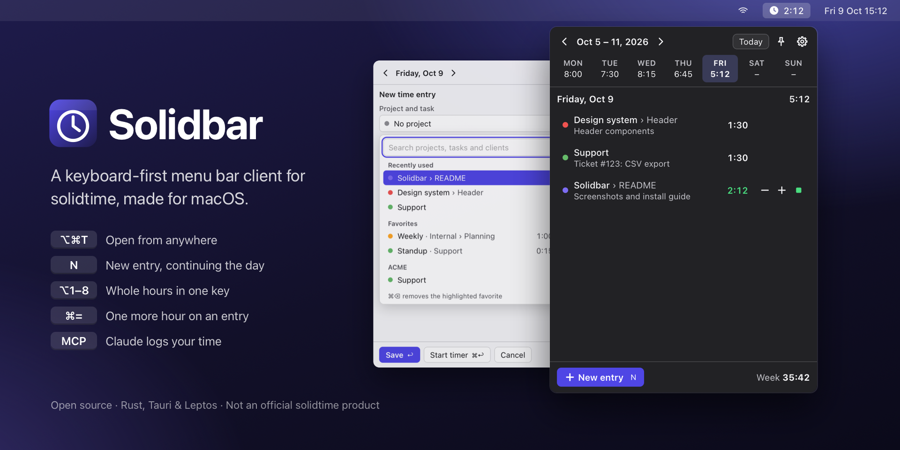
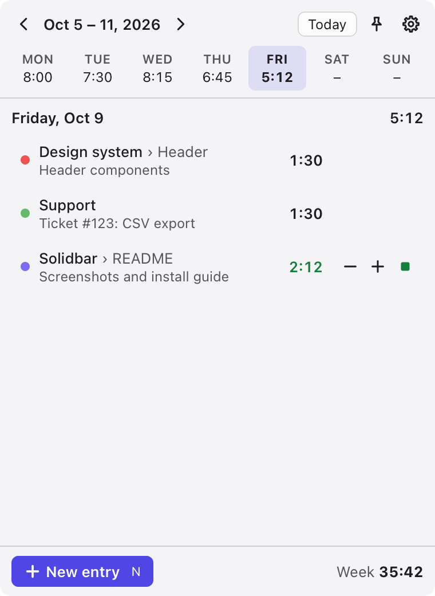
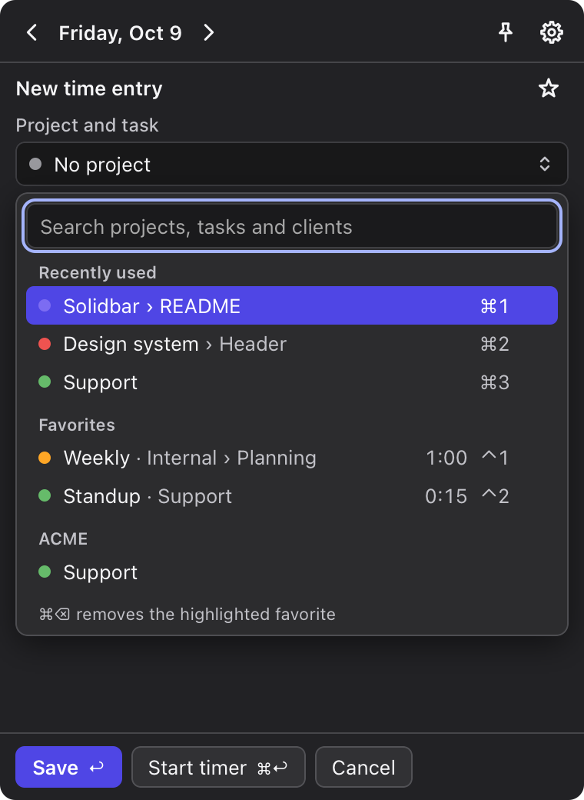
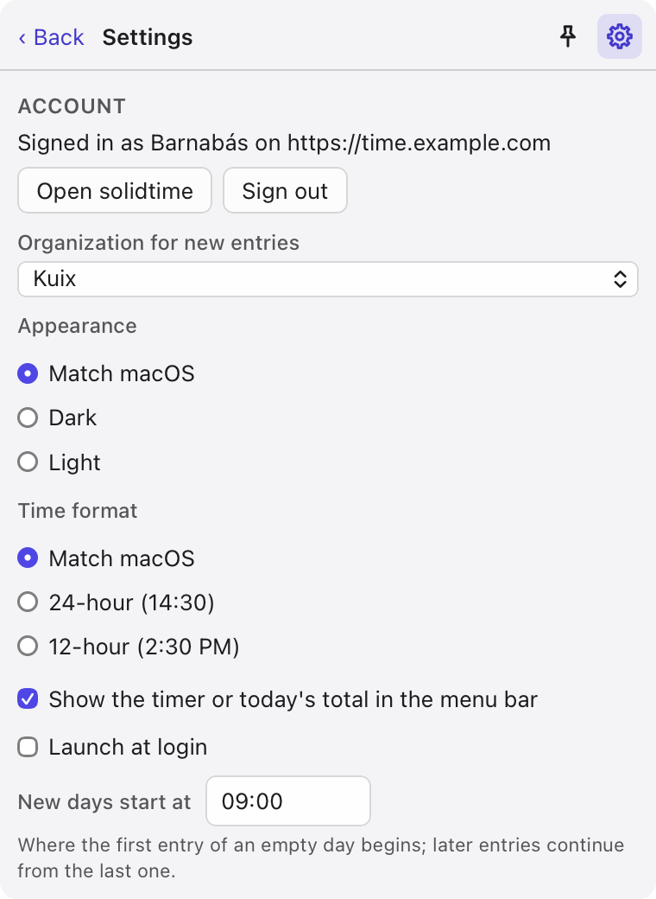

# Solidbar: a keyboard-first menu bar client for solidtime

[](https://github.com/kuix/solidbar/actions/workflows/ci.yml)
[](https://github.com/kuix/solidbar/releases/latest)
[](#license)



Solidbar puts [solidtime](https://www.solidtime.io), the open-source time tracker, in your Mac's menu bar: today's entries, the week at a glance, and a new entry a few keystrokes away.

## Why

The official [solidtime desktop app](https://github.com/solidtime-io/solidtime-desktop) is an Electron window: a lot of app for something you open dozens of times a day, with no global hotkey and few shortcuts. [@matkovsky](https://github.com/matkovsky) missed the keyboard shortcuts the most, so Solidbar does everything from the keyboard. It's a small panel under the menu bar, written in Rust and modelled on Harvest's Mac app.

- **Today first.** The panel opens on today, with a week strip of daily totals above it.
- **Fast entry.** `N`, pick a recent project with `⌘1`–`⌘5` or type to search, `⌥1`–`⌥8` for whole hours, `↩`. New entries continue where the day's last entry ended.
- **±1 hour per row.** `⌘=` / `⌘−` lengthen or shorten an entry; later entries of the day move along so nothing overlaps.
- **Simple timer.** `S` continues the selected entry (or stops the running one). Like solidtime's own list, entries continued on the same day share one row with their total; `→` shows them one by one. The menu bar shows the running time, or today's total.
- **Breaks**, where the organization tracks them: `B` takes a break and ends it, `S` (or `⌥⌘S`) goes back to the work before it. Breaks don't count toward the day's total.
- **One organization at a time.** With several, Solidbar asks which one after signing in; Settings changes it.
- **24- or 12-hour times**, like macOS unless set otherwise in Settings; type `930`, `9:30` or `9:30 pm`.
- **AI agents.** Turn on Settings › AI agents and Claude (or any MCP client) can list your projects and entries, add a week's worth of entries in one go, and fix them, with the same rules as the panel.
- **Keyboard and VoiceOver first.** Every action has a shortcut, most of them a single key like in Harvest; the UI follows WAI-ARIA patterns and is checked against WCAG 2.2 AA with axe in light, dark and increased-contrast modes.

Solidbar is not an official solidtime product.

## Screenshots

| Today | New entry | Settings |
|---|---|---|
|  |  |  |

## Install

1. Download `Solidbar_<version>_universal.dmg` from the [latest release](https://github.com/kuix/solidbar/releases/latest).
2. Open it and drag **Solidbar** to **Applications**.
3. Start Solidbar. It lives in the menu bar (there's no Dock icon); click the clock or press `⌥⌘T`.

Requires macOS 12 or later, on Apple silicon or Intel. Solidbar updates itself; see [Updates](#updates).

## Sign in

Solidbar signs in through your browser with OAuth 2 and PKCE: it creates a new one-time key pair (code verifier and challenge) for every sign-in, so there's no client secret or API token to copy. The tokens are kept in your login keychain.

After you approve Solidbar, the browser comes back to it in one of two ways, and Solidbar asks solidtime which one the OAuth client allows before it opens the browser:

- **`http://127.0.0.1/callback`**, a local address Solidbar listens on while you sign in, on a free port the system picks (OAuth servers accept loopback redirects on any port). Preferred: no other app can take it over.
- **`solidtime://oauth/callback`**, a link macOS hands to Solidbar. Works when Solidbar is in Applications; if the official solidtime desktop app is installed too, macOS may hand the sign-in to that app instead.

### app.solidtime.io

Click **Use app.solidtime.io**, then **Sign in with browser**.

### Self-hosted solidtime

Your instance needs a public OAuth client for Solidbar. Create one where solidtime runs; with the [Docker setup](https://docs.solidtime.io/self-hosting/guides/docker):

```sh
docker compose exec scheduler php artisan passport:client \
  --name=Solidbar --public -n \
  --redirect_uri="http://127.0.0.1/callback,solidtime://oauth/callback"
```

(Without Docker, run the same `php artisan passport:client …` in the solidtime directory.) The command prints the **client ID**. A public client has no secret. A client registered with a port in its loopback address (e.g. `http://127.0.0.1:47821/callback`) works too, as the port doesn't count.

Then, in Solidbar:

1. **solidtime address:** your instance, e.g. `https://time.example.com`.
2. **OAuth client ID:** the ID from the command.
3. **Sign in with browser**, approve Solidbar, and you're back in the panel. If you belong to several organizations, pick the one to work in.

Already set up the official desktop app on your instance (`--name=desktop --redirect_uri=solidtime://oauth/callback`)? Its client ID works too; Solidbar then comes back through the `solidtime://` link.

The instance's own OAuth keys (`PASSPORT_PRIVATE_KEY`, `PASSPORT_PUBLIC_KEY`, from `php artisan self-host:generate-keys`) are part of setting up solidtime itself, not Solidbar.

## Keyboard shortcuts

In the list, where nothing is typed, a single key is enough (`⌘N` and `⌘R` work too, out of macOS habit). Where you type, in the entry form, shortcuts need a modifier. The shortcuts that work from any app use `⌥⌘`. **Settings › Single-key shortcuts** turns the letter keys off, e.g. if you use Voice Control.

| Where | Keys | Action |
|---|---|---|
| Anywhere | `⌥⌘T` | Show or hide Solidbar |
| | `⌥⌘N` | New entry |
| | `⌥⌘S` | Stop the timer, or start one on the last project; after a break, back to work |
| Panel | `←` `→` / `⌥←` `⌥→` | Previous/next day / week |
| | `T` | Today |
| | `↑` `↓` | Select an entry |
| | `→` `←` | Show/hide the entries of a continued row |
| | `↩` or `E` | Edit (a continued row: what its entries share) |
| | `S` | Continue/stop; during a break, back to work |
| | `B` | Take a break / end it (if the organization tracks breaks) |
| | `⌘=` `⌘−` | Add/remove an hour |
| | hold `⌫` | Delete (hold for 2 seconds; letting go earlier keeps the entry) |
| | `N` or `⌘N` | New entry |
| | `R` or `⌘R` | Refresh |
| | `⌘,` | Settings |
| | `⌘O` | Change the organization (in Settings) |
| | `⎋` | Close |
| Entry form | `⌘1`–`⌘5` | Recent project |
| | `⌥1`–`⌥8` | Whole hours |
| | `Space` or type | Open the project list (typing searches) |
| | `↑` `↓` in a time | 15 minutes earlier/later (`⇧` for an hour) |
| | `↩` / `⌘↩` | Save / start a timer (from the Start time, if you changed it; a running timer stops there) |
| | hold **Delete** | Delete: hold the button, or `Space` on it, for 2 seconds |

The global shortcuts can be changed in Settings.

## AI agents (MCP)

Solidbar can be an [MCP](https://modelcontextprotocol.io) server, so AI agents like Claude can work with your time entries: "log 2 hours on Design system for every day last week", "what did I track yesterday?", "move this morning's standup to 9:30". It's off until you turn on **Settings › AI agents**.

The agent works as you, in the organization chosen in Solidbar, and under the panel's rules: dates and times are in your solidtime time zone, an entry without a start time starts where the day's last entry ends, and entries can't cross midnight. The panel shows what agents add or change right away.

| Tool | What it does |
|---|---|
| `list_projects` | Projects with their clients and tasks, and whether they're billable by default |
| `list_time_entries` | Entries on a range of days (up to a year), with totals |
| `add_time_entries` | Adds up to 100 entries in one call; if one doesn't make sense, none is added, and the answer says what to fix |
| `update_time_entry` | Changes an entry's day, times, project, task, description or billable flag |

There's no tool for deleting entries; that stays in the panel.

### Connecting an agent

With AI agents on, Settings shows the server's address (`http://127.0.0.1:<port>/mcp`) and a key, and copies the setup for you:

- **Claude Code**: *Copy for Claude Code* gives a command to run in Terminal:

  ```sh
  claude mcp add --transport http --scope user solidbar http://127.0.0.1:<port>/mcp --header "Authorization: Bearer <key>"
  ```

- **Claude Desktop**, and other apps that start their MCP servers themselves: *Copy for Claude Desktop* gives the entry for `claude_desktop_config.json` (Claude › Settings › Developer › Edit Config); restart Claude after adding it. Solidbar's own binary relays to the app, and starts Solidbar if it isn't running:

  ```json
  {
    "mcpServers": {
      "solidbar": {
        "command": "/Applications/Solidbar.app/Contents/MacOS/solidbar",
        "args": ["mcp"]
      }
    }
  }
  ```

- **Other MCP clients** (Cursor, VS Code, …): use the address with the header `Authorization: Bearer <key>` (Streamable HTTP).

claude.ai in the browser and Claude's cloud connectors can't reach a server on your Mac, so they don't work with Solidbar.

### Security

The server listens on `127.0.0.1` only, so nothing outside your Mac can reach it, and every request needs the key. It refuses requests from web pages (it checks `Host` and `Origin`, against DNS rebinding). The key is stored with Solidbar's settings, readable only by your user. *New key* replaces it; agents set up with the old one need the new one, except Claude Desktop, which reads it from Solidbar. Turning AI agents off closes the port.

## Updates

Solidbar looks for a new release on GitHub when it starts and every six hours, and offers it in the panel ("Restart to update"). Settings › Updates checks right away. Updates are signed; the app only installs archives signed with the project's key.

## Development

Requirements: Rust (pinned in `rust-toolchain.toml`), [trunk](https://trunkrs.dev) 0.21 and the Tauri CLI 2.12 (`cargo binstall trunk@0.21.14 tauri-cli@2.12.1`), Node 24 for the end-to-end tests.

```sh
cargo tauri dev                    # run the app
cargo test --workspace             # unit, property and API tests (wiremock)
cd e2e && npm ci && npx playwright install webkit && npx playwright test
cargo tauri build --target universal-apple-darwin
```

Debug builds keep the session in a private file instead of the keychain, so rebuilds don't trigger keychain prompts.

macOS only delivers `solidtime://` links to an app bundle, so with `cargo tauri dev` sign in with a client that allows `http://127.0.0.1/callback`; otherwise the browser's redirect starts whichever bundle claims the scheme (another Solidbar build, or the official solidtime app).

`cd e2e && npm run artwork` renders the README images (screenshots of the current UI, and the cover) into `docs/images`, and the DMG window background into `src-tauri/dmg`.

Every crate in the app has to be under a license that `deny.toml` allows, and the app ships their license texts in `THIRD_PARTY_LICENSES.html` (Settings › Licenses). After adding or updating dependencies, check them and write the file again; CI fails when it's out of date:

```sh
cargo binstall cargo-deny@0.20.2 cargo-about@0.9.2
cargo deny check licenses
cargo about generate --workspace --locked --fail about.hbs -o THIRD_PARTY_LICENSES.html
```

`e2e/tests/release.spec.ts` runs a release build of the UI under the Content-Security-Policy from `tauri.conf.json`: the dev server doesn't apply the policy, so a mistake there would otherwise only show up as a blank panel in the packaged app.

Layout:

- `crates/shared` — types and pure logic used by both sides: the IPC contract, view models, duration parsing, fuzzy matching.
- `crates/core` — no Tauri: solidtime API client, OAuth, keychain, the time model (stacking, ±1h cascade), the engine that owns state, and the MCP server for AI agents (`mcp`).
- `crates/ui` — the Leptos UI (compiled to WebAssembly).
- `src-tauri` — the macOS shell: menu bar item, the panel (`tauri-nspanel`), global shortcuts, deep links.
- `e2e` — Playwright tests against the UI with a fake backend, including axe accessibility checks.

## Releasing

1. Bump `version` in `Cargo.toml` (workspace) and `src-tauri/tauri.conf.json`.
2. Push a tag: `git tag v0.2.0 && git push origin v0.2.0`.
3. The Release workflow builds the universal app, signs it with the Developer ID certificate, notarizes the app and the DMG (whose window says "drag Solidbar to Applications"), and attaches the DMG, the update archive and `latest.json` to a draft release. Publishing the draft makes the update available to everyone.

To build a DMG without releasing, run the workflow by hand (Actions › Release › Run workflow); the DMG is attached to the run. Without the Apple secrets that build is unsigned.

The workflow needs these repository secrets:

| Secret | What |
|---|---|
| `APPLE_CERTIFICATE`, `APPLE_CERTIFICATE_PASSWORD` | Developer ID Application certificate, exported as `.p12` and base64-encoded, and its password |
| `APPLE_SIGNING_IDENTITY` | e.g. `Developer ID Application: Name (TEAMID)` |
| `APPLE_API_KEY_ID`, `APPLE_API_ISSUER`, `APPLE_API_PRIVATE_KEY` | An App Store Connect team API key for notarization (Users and Access › Integrations › Team Keys, Developer access): its key ID, the issuer ID and the contents of the `.p8` file |
| `TAURI_SIGNING_PRIVATE_KEY`, `TAURI_SIGNING_PRIVATE_KEY_PASSWORD` | The update signing key (`cargo tauri signer generate`) and its password; the public key is in `tauri.conf.json` |

Losing the update signing key means existing installs can't update any more, so keep a copy somewhere safe.

## License

Solidbar is © 2026 kuix design s.r.o. and the Solidbar contributors, available under the [MIT License](LICENSE-MIT) or the [Apache License 2.0](LICENSE-APACHE), at your option. It comes as is, without warranty of any kind.

It's built with open-source crates under their own licenses (MIT, Apache-2.0, BSD-3-Clause, MPL-2.0 and others); [`THIRD_PARTY_LICENSES.html`](THIRD_PARTY_LICENSES.html) lists them with their texts, and the app opens it from Settings › Licenses.

Unless you explicitly state otherwise, any contribution intentionally submitted for inclusion in Solidbar by you, as defined in the Apache-2.0 license, shall be dual licensed as above, without any additional terms or conditions.
